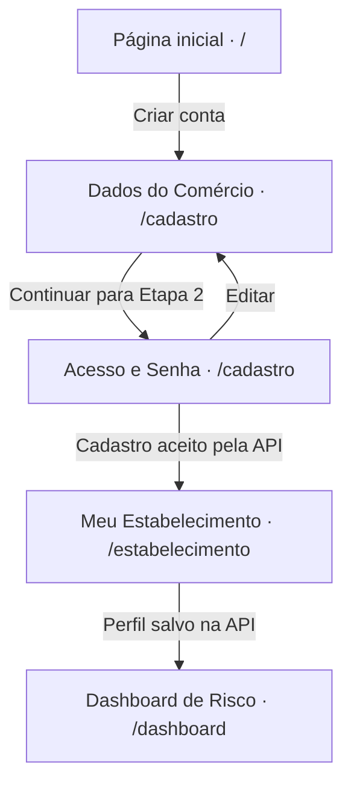

# Navegação

## Primeiro acesso ao painel de risco

Este fluxo acompanha quem ainda precisa cadastrar o comércio e completar seu perfil para consultar o risco no painel.

As duas etapas do cadastro compartilham a mesma URL. Após o cadastro, o front-end salva a sessão e carrega o perfil antes de exibir **Meu Estabelecimento**. Erros de cadastro ou de salvamento aparecem no formulário correspondente. O painel consulta o risco para o bairro do estabelecimento quando o perfil informa o bairro.

## Mapa de rotas

| Rota | Tela | Acesso |
| --- | --- | --- |
| `/` | Página inicial | Público |
| `/entrar` | Entrar | Público |
| `/cadastro` | Criar conta de comerciante | Público |
| `/dashboard` | Dashboard de Risco | Sessão e perfil |
| `/historico` | Histórico de Alertas | Sessão e perfil |
| `/checklist` | Checklist de Prevenção | Sessão e perfil |
| `/ocorrencias` | Registro de Ocorrências | Sessão e perfil |
| `/ocorrencias/lista` | Ocorrências registradas | Sessão e perfil |
| `/estabelecimento` | Meu Estabelecimento | Sessão e perfil |
| `/admin/whatsapp` | WhatsApp Admin | Sessão, perfil e papel `ADMIN` |

O login bem-sucedido abre `/dashboard`. O botão **Sair** encerra a sessão local e volta para `/`. O menu das telas operacionais permite alternar entre painel, alertas, checklist, registro de ocorrências e estabelecimento. Abra **Ver ocorrências registradas** em `/ocorrencias` para acessar a lista.

## Proteção de rotas

- Sem sessão, `RequireAuth` encaminha rotas protegidas para `/entrar`. Se a sessão existir e o perfil ainda precisar ser carregado, a interface exibe um estado de espera. Se essa consulta falhar e a sessão continuar ativa, a tela mostra o erro e oferece **Tentar novamente**.
- Uma resposta `401` a uma chamada autenticada encerra a sessão local. Em rotas protegidas, a pessoa volta para `/entrar`.
- `RequireAdmin` redireciona contas sem o papel `ADMIN` para `/dashboard`. O menu exibe **WhatsApp Admin** para contas com esse papel.
- Caminhos desconhecidos redirecionam para `/`. Em produção, o host precisa servir `index.html` ao abrir diretamente uma rota da SPA. As regras estão em [`vercel.json`](../vercel.json) e [`public/_redirects`](../public/_redirects).

As rotas e proteções ficam em [`src/App.jsx`](../src/App.jsx). O menu operacional fica em [`src/components/AppShell.jsx`](../src/components/AppShell.jsx).
